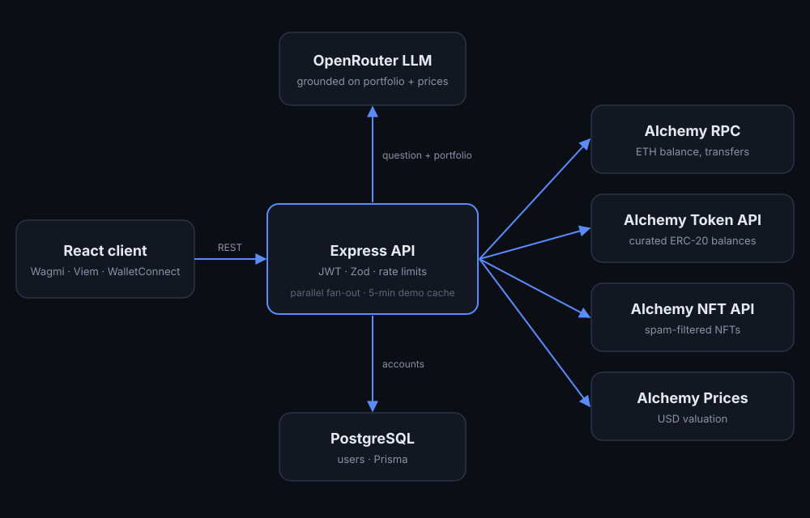

# AtlasAI

**Ethereum portfolio analytics with an AI assistant that answers from your real wallet data.**

AtlasAI pulls balances, ERC-20 tokens, NFTs and transaction history from Alchemy, prices them with live market data, and lets you ask questions about the portfolio in plain English.

**[Try the live demo](https://atlas-ai-ashy-six.vercel.app/demo)** (no account or wallet needed; it loads a well-known public wallet).

## Screenshots

### Authentication

<p align="center">
  
  
</p>

### Portfolio Dashboard

<p align="center">
  
</p>

### Market Watchlist

<p align="center">
  
</p>

### AI Assistant & Transaction History

<p align="center">
  
</p>

> Screenshots use representative portfolio values for demonstration purposes. Live portfolio data is retrieved from the connected wallet and supported data providers.

---

## Architecture



## Engineering highlights

- **One normalised portfolio API.** `GET /api/portfolio/:address` fans out to four upstream sources in parallel (native balance, token balances, NFTs, transfers), prices the holdings and returns a single typed response with USD totals. NFT or price failures degrade that section instead of failing the request.
- **Spam-resistant token data.** Balances are queried for a curated list of major ERC-20 contracts with known decimals, so airdropped spam tokens never reach the UI and no per-token metadata calls are needed. NFTs from spam-flagged contracts are filtered out.
- **Grounded AI answers.** The assistant receives the actual portfolio plus live prices for any asset the question mentions, and is instructed never to invent balances or prices. Questions are validated (Zod, 500 chars) and rate limited to protect the model budget.
- **Public demo without abuse.** `/api/demo/portfolio` serves a public wallet from a five-minute cache with request coalescing, so traffic spikes cost one upstream call.
- **Security basics done properly.** bcrypt password hashing, JWT auth with no fallback secret (the server refuses to start without one), Ethereum address validation, per-IP rate limits on auth, prices, demo and AI routes, a configurable CORS allowlist and a JSON body size cap.
- **Wallet connection** with WalletConnect, RainbowKit, Wagmi and Viem.

## API

| Method | Route | Auth | Purpose |
|---|---|---|---|
| POST | `/api/auth/register`, `/api/auth/login` | — | Accounts and JWTs |
| GET | `/api/portfolio/:address` | JWT | Portfolio for a connected wallet |
| GET | `/api/demo/portfolio` | — | Cached demo portfolio |
| GET | `/api/prices?symbols=ETH,BTC` | — | Live USD prices |
| POST | `/api/ai/portfolio` | — | Ask the assistant (rate limited) |
| GET | `/health` | — | Liveness |

## Run locally

```bash
# server
cd server && cp .env.example .env   # DATABASE_URL, JWT_SECRET, ALCHEMY_API_KEY, OPENROUTER_API_KEY
npm install && npx prisma migrate dev && npm run dev

# client
cd client && npm install && npm run dev   # VITE_API_URL, VITE_WALLETCONNECT_PROJECT_ID
```

Optional server settings: `CLIENT_ORIGIN` (comma-separated CORS allowlist), `DEMO_WALLET_ADDRESS`, `DEMO_WALLET_LABEL`.

## Stack

React · TypeScript · Vite · Wagmi · Viem · RainbowKit · Node.js · Express 5 · Prisma · PostgreSQL · Zod · JWT · bcrypt · Alchemy · OpenRouter
