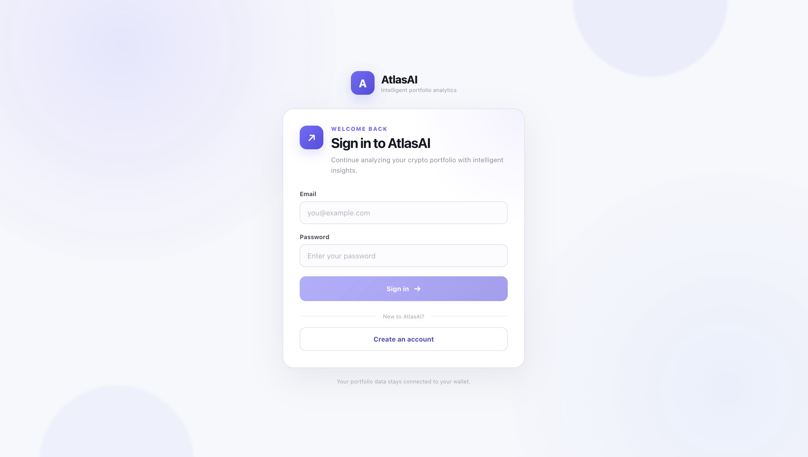
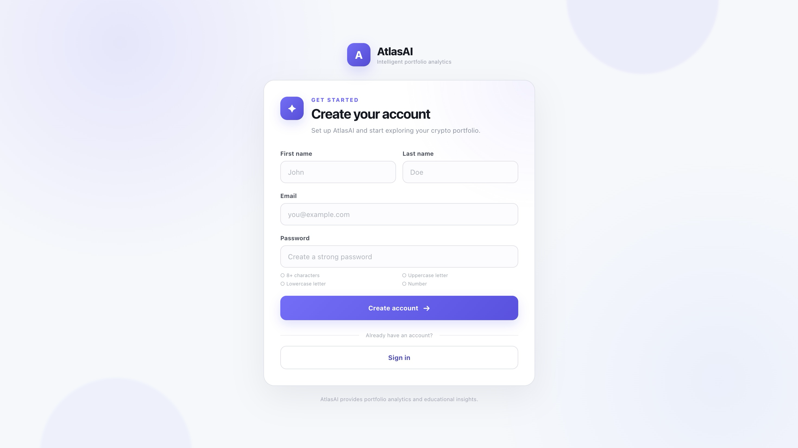
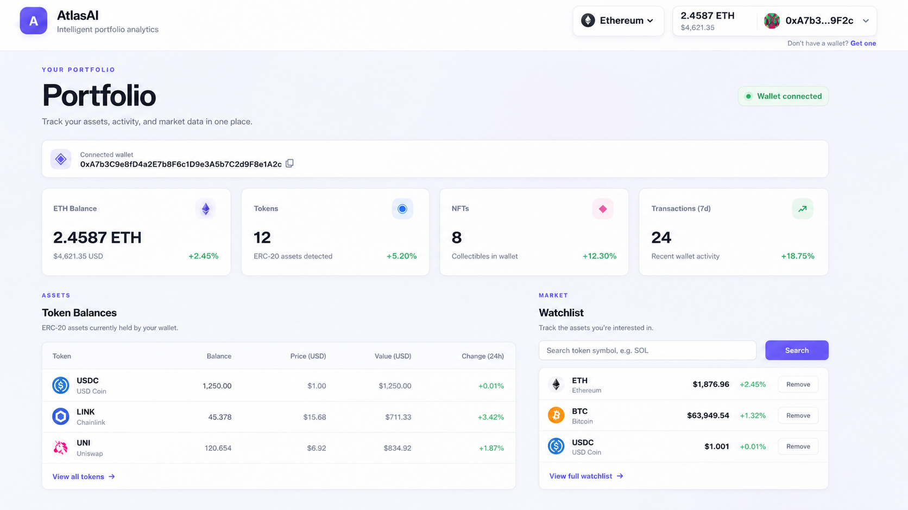
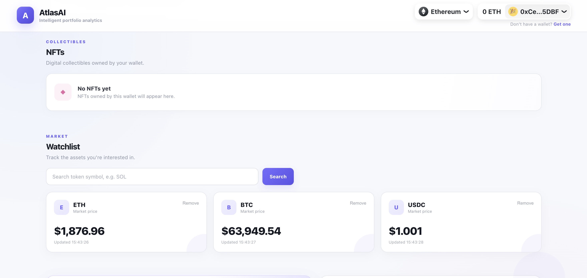

# AtlasAI

**AtlasAI is a full-stack Web3 portfolio analytics platform that combines Ethereum wallet data, cryptocurrency market data, and AI-powered insights in one dashboard.**

Users can connect their wallet, explore their assets and transaction activity, monitor token prices, and ask AtlasAI questions about their portfolio.

---

## Screenshots

### Authentication

<p align="center">
  
  
</p>

### Portfolio Dashboard

<p align="center">
  
</p>

### Market Watchlist

<p align="center">
  
</p>

### AI Assistant & Transaction History

<p align="center">
  
</p>

> Screenshots use representative portfolio values for demonstration purposes. Live portfolio data is retrieved from the connected wallet and supported data providers.

---

## Features

### 🔐 Authentication

- User registration and login
- JWT-based authentication
- Password hashing with bcrypt
- Zod request validation
- Protected API routes
- Persistent authentication state

### 👛 Web3 Wallet Integration

- Ethereum wallet connection
- WalletConnect integration
- Connected wallet address display
- Native ETH balance tracking
- Wallet onboarding and help page
- Wallet-specific portfolio data

### 📊 Portfolio Analytics

- Ethereum balance tracking
- ERC-20 token detection
- NFT detection
- Recent transaction history
- Seven-day transaction activity visualization
- Portfolio data available to the AI assistant

### 📈 Token Watchlist

- ETH, BTC, and USDC watchlist
- Search for additional tokens
- Add and remove tokens
- Market price retrieval
- Price update timestamps

### 🤖 AI Portfolio Assistant

- Ask questions about wallet activity
- Analyze available portfolio data
- Generate contextual portfolio insights
- Portfolio-aware AI prompts
- AI responses displayed directly inside the dashboard

### 🧾 Transaction Activity

- Recent wallet activity
- Incoming and outgoing transactions
- Token swaps
- Contract interactions
- Transaction amounts and timestamps
- Seven-day transaction activity visualization

### 🎨 Responsive UI

- Modern dashboard interface
- Responsive authentication pages
- Loading states
- Empty states
- Error handling
- Mobile-friendly layouts
- Consistent AtlasAI design system

---

## Tech Stack

### Frontend

- React
- TypeScript
- Vite
- React Router
- Wagmi
- Viem
- Axios
- CSS

### Backend

- Node.js
- Express
- TypeScript
- Prisma
- PostgreSQL
- Zod
- JWT
- bcrypt

### Web3 & Blockchain

- Ethereum
- WalletConnect
- Alchemy
- ERC-20 token data
- NFT data
- Wallet transaction data

### AI & External APIs

- AI-powered portfolio analysis
- Context-aware portfolio prompts
- Cryptocurrency market data APIs
- Backend AI service integration

---

## Architecture

AtlasAI follows a client-server architecture that separates the React frontend from the backend API and external data services.

```text
                    ┌──────────────────────┐
                    │       AtlasAI        │
                    │   React + TypeScript │
                    └──────────┬───────────┘
                               │
                         REST API / Axios
                               │
                    ┌──────────▼───────────┐
                    │     Express API      │
                    │    Node + TypeScript │
                    └──────────┬───────────┘
                               │
          ┌────────────────────┼────────────────────┐
          │                    │                    │
          ▼                    ▼                    ▼
     PostgreSQL             Alchemy            Market Data
       Prisma            Blockchain Data          APIs
          │                    │                    │
          └────────────────────┼────────────────────┘
                               │
                               ▼
                         AI Service
## Recruiter demo mode

The dashboard is also available at `/demo`, allowing visitors to explore the market watchlist, AI assistant, empty portfolio/NFT states and transaction UI without connecting a wallet. Connecting a wallet remains optional and enables live wallet-specific data when the user is authenticated.
